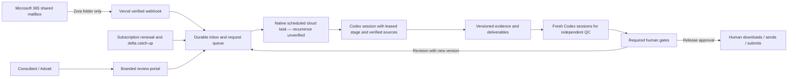

# Zora: product and implementation blueprint

## Intended outcome

Zora is Mindmap Digital’s first-level solutions consultant: it receives a pursuit request, establishes what the client is buying, assembles the right deliverable, checks it independently and works with named humans until release. The first pilot includes **all eight BRD workflows**, plus S1 commercials and S2 QC.

This is a custom build. It follows the supplied BRD, company deck, slide templates and architecture formats. The user’s later instruction overrides the BRD’s proposed Claude integration: **all reasoning, research and content creation happen in Codex sessions. There is no Claude SDK, model API key or direct model API integration.** Microsoft Graph is the mailbox transport; Vercel is the web host.

## Mindmap understanding from the supplied deck

Source: `AI_Solutioning_Agent_BRD_v1.0/MindMap AI Business Deck Oct 2026.pdf`, 19 image-only pages, with OCR extracted during onboarding. OCR was used for study; numerical and certification claims require visual source checks and approved company-profile entries before client release.

- Positioning: sovereign AI installed inside client infrastructure, with forward deployed engineers accountable for outcomes.
- Product: MindMap OS combines an accelerator library, model estate and deploy kit. Accelerators combine a domain model, workflow logic, connectors, guardrails/human review and audit.
- Named model families: Charaka, Lekha, Vanij, Bhasha and Rasayana. The deck distinguishes production, proof-of-concept and development statuses; Zora must preserve those distinctions.
- Business lines: AI Centre of Excellence, Service-as-a-Software, sovereign model families and industry solutions.
- Engineering practices: test automation, RPA/intelligent automation, data/analytics, digital engineering, work management/Smartsheet, managed support, staff augmentation and AI skilling.
- Commercial positioning: outcomes/transactions and retainers, with enterprise delivery and partner channels. Proposals still follow the BRD’s explicit S1 review and client-commercials format.
- Reported case outcomes and company counts are source claims, not automatically approved assertions. Customer logos do not imply endorsement. Anonymised cases stay anonymised unless disclosure is authorised.

Website research now includes the homepage, About, MindMap OS, Model Estate, DocGenie and customer-stories pages. Evidence snapshots are retained outside the checkout under `/workspace/solve-environment/research`. The Model Estate page explicitly lists two live/stable families, Vanij in limited production, Bhasha in POC and Rasayana in development; preserve those statuses rather than repeating a blanket production claim from a different source. See [the sourced company notes](MINDMAP_KNOWLEDGE.md).

For client solution architectures, Zora must derive hosting and data movement from client evidence. Zora’s own Vercel/Codex infrastructure is a separate internal presales deployment; it is not evidence that a client solution runs inside the client perimeter.

## Brand and interaction

Zora uses a clean blue-and-white portal, with blue `#2563eb` accents/orb and white navigation. Its email identity remains a **magenta orb**, using `#d62ca4`. Emails use an Outlook-friendly table layout with a magenta stripe as the first visible element, the Zora orb identifier and “Zora · Mindmap Digital” signature.

The shared mailbox display name must not be renamed globally: Jarvis also uses it. Zora identifies its own messages through the routing marker, HTML header and signature. No automatic sending is implemented; the BRD keeps sending as a human action.

## Runtime architecture

Vercel request handlers do not host a permanent Codex process. Saurabh selected a standalone native cloud task every five minutes. The bounded bridge claims one leased stage, downloads its sources/prior files and persists actual outputs after the current Codex session works on them. No schedule is saved or recurrence verified. An authorised human can also use a request pack in a fresh session. Queueing a request does not itself wake Codex. The optional CLI runner is not the selected pilot prerequisite.

The connected Neon PostgreSQL service retains pursuits, jobs, leases, private source/artifact bytes and hashes, mail cursors, audit events, team assignments and version-bound approvals. Files use 2 MB transfers with a 32 MB per-file limit. Internal workpapers require both pursuit access and an authorised internal role. No model API keys are needed.

## Workflow contract

| Workflow | Deliverable | Critical gates / conditions |
|---|---|---|
| W1 | Company-specific intro PPT | Five evidence-backed pain points; consultant approves pain points and deck; every slide is an edited template duplicate |
| W2 | Existing demo/video shortlist and talk track | Approved demo/video library; relevance, branding and data checks; consultant approves picks |
| W3 | Transcript-based PPT or detailed Word/PDF | Timestamped requirements; locked baseline; architect approval; independent QC; human proofread; S1; deep QC; release |
| W4 | RFP response in buyer format/order | Clause reconciliation; independent understanding; locked baseline; technical design; deviations approved individually; five pre-draft checks; human proofread; S1; submission check; release |
| W5 | Buyer question sheet plus separate internal tracker | Questions must be unanswered and necessary; simple and complex columns; no company name in anonymised bidder Q&A; bid owner/consultant approves |
| W6 | Functional domain demo, specifications, test log and run sheet | Domain owner approves process map; 10–12 meaningful sub-agents; real in/out-of-sample tests; joint readiness approval |
| W7 | Branded walkthrough video | Working demo and run sheet; approved voice/recording tools; no build platform visible; consultant and demo builder approve |
| W8 | Branded email draft | Sourced facts; calm tone; no free demo/POC or unapproved promises; human proofreads and sends |

W1/W3/W4/W5/W6/W7 wait at routing confirmation; W2/W8 show the routing card and proceed. Ambiguous requests must be resolved by the consultant; email ingestion must not guess a workflow from a weak keyword.

## Evidence, QC and confidentiality

The Pursuit Case File contains source documents, evidence passages, requirement versions, parameters, draft versions, QC reports, findings, decisions, approvals and routing history. Every claim links to its document/page/clause/timestamp. Later sources supersede earlier ones explicitly; both are retained where they conflict.

Independent reviewers start fresh with only sources, baseline/reference, draft and checklist. They do not see drafter reasoning or previous reviews. Each pass has a unique run ID and complete element coverage. A new reviewer verifies a fix. Disagreements go to humans.

D1 compliance, D2 contradiction, D3 internal consistency, D4 scope/promises, D5 visuals/tables, D6 proofread, D7 commercials and D8 source check follow the per-workflow BRD profiles. Two consecutive clean loops are the proposed general exit rule; deep QC runs until clean. A configured loop maximum sends unresolved findings to a human.

Pre-draft contradictions and QC escapes at document gates trigger ESC1–ESC4: log, explain, reset trust/re-evaluate in a fresh creation context, and rerun the relevant checks. Reviewers must not claim success from an empty coverage log or invented test output.

Internal man-hours, rates, overhead, AI reduction, margins and commercial reasoning remain separate from client output and are visible only to the authorised commercial roles. Client prices appear only in the one commercial table or required buyer schedule. Architecture data sources must name the actual system/feed and the data it supplies. The BRD’s 17 house rules remain the authoritative checklist.

## Current implementation and next milestones

Implemented foundation: branded portal, all-eight workflow catalogue, BRD index, case creation, connected database and stage queue, role/version-bound gates, Microsoft sign-in, Zora-folder-only notifications/delta sync/subscription renewal, native-session bridge, email file/inline attachment intake, source uploads, generated-file storage/download and safe text review, pursuit team access and audited revision/resume.

Independent review now has a durable queue, file/purpose isolation, server document inventory, context/hash/coverage validation, configured clean loops, privacy and revision cancellation. Actual fresh Codex tasks and semantic review quality remain unaccepted; full ESC trust-reset/fix automation, large-document/unsupported media paths, interactive sign-in/routing, recurring scheduling and consultant-quality W1–W8 production still need work/testing. The native transport can resolve the existing private bypass at runtime, while the saved binding remains unchanged.

Those items are pending work. Stage results must match stored files; review passes must match independent leases and server coverage; missing policy/evidence holds. An automatic pilot cannot be called ready until real sessions, sources, reviews and human decisions pass acceptance.

## Inputs and decisions still needed

1. Create and verify the chosen native cloud schedule; no schedule-management tool is exposed in this task.
2. Advait's named sales and demo-builder accounts, plus interactive sign-in testing. Mailbox routing, his work email and initial roles are already confirmed.
3. Any required data-region restriction beyond the currently connected Neon service.
4. CompareIQ Word layout is supplied; company-profile claims and actual draft/carryover checks remain.
5. Drive demo/video library and transcripts are supplied; working app access, maturity and permitted reuse still need confirmation.
6. Tender code and real RFP/RFI/response packs are supplied; domain expectations, numerical tolerances and real functional acceptance remain.
7. Voice, recording and editing tools for W7, compatible with the no-model-API requirement.
8. BRD “To set” business values, currency/geographic rate rules, question caps, classifier thresholds, loop limits and other acceptance tolerances. No guessed value should become a client commitment.
